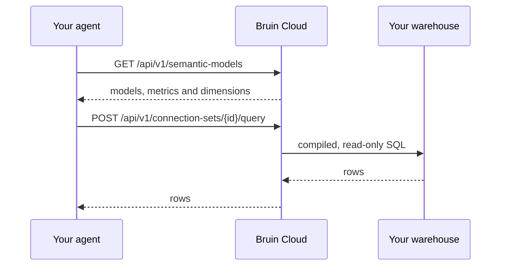

# Use Bruin Cloud as Your Agent's Query Backend

If you are building your own AI agent, Bruin Cloud can act as its query backend. You store your warehouse credentials in Bruin once. Your agent then calls a small HTTP API, and Bruin takes care of the rest: it connects with the stored credentials, runs the query safely, and returns the rows. The agent never handles a database password and never needs a database driver.

Pair it with a [semantic layer](/core-concepts/semantic-layer) and your agent doesn't have to write SQL at all. It asks for metrics and dimensions by name, for example "average price by month on weekdays", and Bruin compiles that request into SQL from your model definitions.



To set up, do these steps in Bruin Cloud:

1. Save your warehouse credentials in a **connection set**.
2. Create a **team API token** for your agent.
3. Connect the **repository with your semantic models**. If your agent only runs SQL, skip this step.

## How Bruin keeps your data safe

- **Credentials stay in Bruin.** Bruin keeps connection details encrypted in a dedicated secrets backend. The API never returns them.
- **All queries are read-only.** Bruin parses each SQL statement and rejects all statements that are not `SELECT` or `WITH`. Bruin fills in template variables before this check. If the database supports it, the query also runs in a read-only transaction.
- **Semantic queries do not contain SQL.** Bruin builds the SQL from your model definitions. Filter values go into the SQL as escaped literals.
- **Queries are stateless.** Bruin runs each request independently and does not keep the results.
- **Queries are audited.** Bruin records each query in your team's [audit log](/cloud/audit-logs), with the token and the time.

::: tip Use read-only credentials
Bruin enforces these safeguards. For the strongest protection, also use a database user that can only read. Give it access only to the schemas that your agent needs.
:::

## 1. Save your warehouse credentials

A **connection set** is a named group of connections. Go to **AI → Settings → Connection Sets** and click **Add connection set**.


Type a name for the set, for example `production`. Click **Add Connection**, select your warehouse type and enter the credentials. Queries use the **Connection Name** to find this connection, so use a stable name like `warehouse`.


The set **ID** shows next to the set name. The query API uses this ID. Click the ID to copy it.


### Or create the set with the API

You can also create the set with a token that has the `connection-set:create` ability:

```bash
curl -X POST https://cloud.getbruin.com/api/v1/connection-sets \
  -H "Authorization: Bearer $BRUIN_TOKEN" \
  -H "Content-Type: application/json" \
  -d '{
    "name": "production",
    "connections": [{
      "type": "postgres",
      "name": "warehouse",
      "config": {
        "host": "db.example.com",
        "port": 5432,
        "username": "analytics_reader",
        "password": "…",
        "database": "analytics",
        "sslmode": "require"
      }
    }]
  }'
```

```json
{ "id": 2, "name": "production" }
```

Bruin tests the connection before it saves the set.

## 2. Create a team API token

Go to **Team Settings → API Keys**. Type a name for the token, select **Custom** access and select these abilities:

| Ability | Needed for |
|---|---|
| `connection:query` | Run queries |
| `connection-set:list` | Use a connection set |
| `semantic:list` | List semantic models |


Copy the token. You cannot see it again. Send it with each request:

```text
Authorization: Bearer <token>
```

A team token acts for the team, not for a person. For expiry and personal tokens, see [API Tokens](/cloud/api-tokens).

## 3. Add your semantic models

If your agent only runs SQL, skip this step.

Put your semantic models in a `semantic` directory at the root of your repository:

```text
my-repo/
├─ .bruin.yml
├─ pipelines/
└─ semantic/
   ├─ market_days.yml
   └─ battery.yml
```

A model has a source table, a **connection**, dimensions, metrics and segments:

```yaml
schema: v1
name: market_days
label: DE-LU market days
description: Daily day-ahead power prices and their drivers.

source:
  table: marts.price_drivers
  connection: warehouse      # matches the connection name in your connection set

dimensions:
  - name: day
    type: time
    granularities:
      day: day
      week: date_trunc('week', day)::date
      month: date_trunc('month', day)::date
  - name: price_regime
    type: string
    expression: >-
      case when negative_price_hours > 0 then 'negative hours'
           when avg_price_eur_mwh < 50 then 'low'
           when avg_price_eur_mwh < 100 then 'normal'
           else 'high' end

metrics:
  - name: avg_price
    label: Avg price (EUR/MWh)
    expression: round(avg(avg_price_eur_mwh), 2)::float
  - name: days
    expression: count(*)
  - name: negative_price_days
    expression: count(*)
    filter: negative_price_hours > 0
  - name: negative_day_share
    expression: "round(100.0 * {negative_price_days} / {days}, 1)::float"

segments:
  - name: weekdays
    filter: extract(isodow from day) < 6
```

For the full model format, see [Semantic Layer](/core-concepts/semantic-layer). To validate your models before you push, use [`bruin semantic`](/commands/semantic).

To connect the repository, go to **Team Settings → Projects → Connect with GitHub** and select the repository. Bruin Cloud reads the models at each sync. You can see them in **Catalog → [Semantic Layers](/cloud/semantic-layers)**.


## 4. Query from your agent

### List the semantic models

Give this list to your agent, so that it knows the available names.

```bash
curl https://cloud.getbruin.com/api/v1/semantic-models \
  -H "Authorization: Bearer $BRUIN_TOKEN"
```

```json
{
  "models": [{
    "name": "market_days",
    "label": "DE-LU market days",
    "description": "Daily day-ahead power prices and their drivers.",
    "connection": "warehouse",
    "dimensions": [
      { "name": "day", "label": null, "description": null, "type": "time", "granularities": ["day", "week", "month"] },
      { "name": "price_regime", "label": null, "description": null, "type": "string", "granularities": [] }
    ],
    "metrics": [
      { "name": "avg_price", "label": "Avg price (EUR/MWh)", "description": null, "format": null },
      { "name": "negative_day_share", "label": null, "description": null, "format": null }
    ],
    "segments": [{ "name": "weekdays", "label": null, "description": null }],
    "joins": []
  }]
}
```

The response does not include SQL definitions or hidden fields.

### Run a semantic query

Request metrics by name, grouped by dimensions:

```bash
curl -X POST https://cloud.getbruin.com/api/v1/connection-sets/2/query \
  -H "Authorization: Bearer $BRUIN_TOKEN" \
  -H "Content-Type: application/json" \
  -d '{
    "semantic_query": {
      "model": "market_days",
      "dimensions": [{ "name": "day", "granularity": "month" }],
      "metrics": ["avg_price", "negative_day_share"],
      "segments": ["weekdays"],
      "sort": [{ "name": "day", "direction": "desc" }],
      "limit": 3
    }
  }'
```

```json
{
  "columns": ["day", "avg_price", "negative_day_share"],
  "column_types": ["DATE", "FLOAT8", "FLOAT8"],
  "rows": [
    ["2026-07-01T00:00:00Z", 111.84, 25],
    ["2026-06-01T00:00:00Z", 124.89, 9.1],
    ["2026-05-01T00:00:00Z", 108, 50]
  ],
  "rendered_sql": "SELECT date_trunc('month', day)::date AS day, round(avg(avg_price_eur_mwh), 2)::float AS avg_price, … FROM marts.price_drivers WHERE extract(isodow from day) < 6 GROUP BY 1 ORDER BY day DESC LIMIT 3"
}
```

`rendered_sql` is the SQL that Bruin generated. This request has no `connection` field, so Bruin uses the connection of the model (`warehouse`). For all fields, see the [reference](#query-endpoint-reference).

### Filter the results

Use `filters` to limit the rows. Use `segments` to apply filters that the model defines. This request gets weekday counts and average prices since June, for high-price and negative-price days only:

```bash
curl -X POST https://cloud.getbruin.com/api/v1/connection-sets/2/query \
  -H "Authorization: Bearer $BRUIN_TOKEN" \
  -H "Content-Type: application/json" \
  -d '{
    "semantic_query": {
      "model": "market_days",
      "dimensions": [{ "name": "day", "granularity": "month" }, { "name": "price_regime" }],
      "metrics": ["days", "avg_price"],
      "filters": [
        { "dimension": "day", "operator": "gte", "value": "2026-06-01" },
        { "dimension": "price_regime", "operator": "in", "value": ["high", "negative hours"] }
      ],
      "segments": ["weekdays"],
      "sort": [{ "name": "day", "direction": "asc" }]
    }
  }'
```

```json
{
  "columns": ["day", "price_regime", "days", "avg_price"],
  "column_types": ["DATE", "TEXT", "INT8", "FLOAT8"],
  "rows": [
    ["2026-06-01T00:00:00Z", "high", 18, 134.31],
    ["2026-06-01T00:00:00Z", "negative hours", 2, 67.8],
    ["2026-07-01T00:00:00Z", "high", 7, 134.1],
    ["2026-07-01T00:00:00Z", "negative hours", 3, 68.55]
  ],
  "rendered_sql": "SELECT date_trunc('month', day)::date AS day, … AS price_regime, count(*) AS days, round(avg(avg_price_eur_mwh), 2)::float AS avg_price FROM marts.price_drivers WHERE day >= '2026-06-01' AND … IN ('high', 'negative hours') AND extract(isodow from day) < 6 GROUP BY 1, 2 ORDER BY day ASC"
}
```

Bruin combines all filters and segments with `AND`. For all operators, see [Filters](#filters).

### Run raw SQL

Send `query` instead of `semantic_query`. Bruin accepts only `SELECT` and `WITH` statements. The `connection` field is required.

```bash
curl -X POST https://cloud.getbruin.com/api/v1/connection-sets/2/query \
  -H "Authorization: Bearer $BRUIN_TOKEN" \
  -H "Content-Type: application/json" \
  -d '{
    "connection": "warehouse",
    "query": "SELECT day, avg_price_eur_mwh FROM marts.price_drivers ORDER BY day DESC LIMIT 2"
  }'
```

```json
{
  "columns": ["day", "avg_price_eur_mwh"],
  "column_types": ["DATE", "NUMERIC"],
  "rows": [["2026-07-16T00:00:00Z", "159.86"], ["2026-07-15T00:00:00Z", "136.42"]],
  "rendered_sql": "SELECT day, avg_price_eur_mwh FROM marts.price_drivers ORDER BY day DESC LIMIT 2"
}
```

To use variables, put Jinja placeholders in the SQL and send the values in `query_params`, as with `bruin query --var`. Bruin inserts the values as written, so put quotes around string placeholders:

```json
{
  "connection": "warehouse",
  "query": "SELECT count(*) AS days FROM marts.price_drivers WHERE day >= '{{ start_date }}'",
  "query_params": { "start_date": "2026-07-01" }
}
```


### Wire it into your agent

Usually, your agent needs two tools: one to list the models and one to run a query. For example, in Python:

```python
import os, requests

BRUIN = "https://cloud.getbruin.com/api/v1"
HEADERS = {"Authorization": f"Bearer {os.environ['BRUIN_TOKEN']}"}
CONNECTION_SET_ID = 2

def list_semantic_models() -> dict:
    """Models, dimensions, metrics and segments the agent can query."""
    return requests.get(f"{BRUIN}/semantic-models", headers=HEADERS, timeout=30).json()

def semantic_query(query: dict) -> dict:
    """Run a semantic query, e.g. {"model": "market_days", "metrics": ["avg_price"]}."""
    r = requests.post(f"{BRUIN}/connection-sets/{CONNECTION_SET_ID}/query",
                      headers=HEADERS, json={"semantic_query": query}, timeout=120)
    return r.json()
```

Give errors to your agent as they are. The `message` tells the agent what to correct.

## Query endpoint reference

```text
POST /api/v1/connection-sets/{connectionSetId}/query
```

Base URL: `https://cloud.getbruin.com`. Runs one read-only query on a connection in a connection set.

### Authentication

| Header | Required | Value |
|---|---|---|
| `Authorization` | yes | `Bearer <token>`. The token needs the `connection:query` and `connection-set:list` abilities. |
| `Content-Type` | yes | `application/json` |
| `X-Bruin-Team` | for multi-team personal tokens | The team. Team tokens do not need it. |

### Path parameter

| Parameter | Type | Description |
|---|---|---|
| `connectionSetId` | integer | The connection set ID. It shows in **AI → Settings → Connection Sets**. `GET /api/v1/connection-sets` also returns it. |

### Request body

| Field | Type | Required | Description |
|---|---|---|---|
| `semantic_query` | object | yes† | A query on a semantic model. See below. |
| `query` | string | yes† | SQL. Only `SELECT` and `WITH` statements. |
| `connection` | string | with `query` | A connection name in the set. For semantic queries, the default is the `source.connection` of the model. |
| `query_params` | object | no | Values for Jinja placeholders in `query`. Not with `semantic_query`. |

† Send `semantic_query` or `query`, not both.

#### `semantic_query`

| Field | Type | Required | Description |
|---|---|---|---|
| `model` | string | yes | The model name, from `GET /api/v1/semantic-models`. Bruin also loads the models that it joins to. |
| `dimensions` | array of objects | no* | The dimensions to group by: `{ "name": "...", "granularity": "..." }`. |
| `dimensions[].name` | string | yes | A dimension of the model. For a joined model, use `<join name>.<dimension>`, for example `customers.country`. |
| `dimensions[].granularity` | string | no | The time grain of a `time` dimension, for example `month`. It must be in the `granularities` of the dimension. |
| `metrics` | array of strings | no* | The metrics to calculate. |
| `filters` | array of objects | no | Conditions on dimensions. See [Filters](#filters). |
| `segments` | array of strings | no | Filters that the model defines, for example `weekdays`. |
| `sort` | array of objects | no | `{ "name": "...", "direction": "asc" }`. `name` is a dimension or metric in the query. `direction` is `asc` (default) or `desc`. |
| `limit` | integer | no | The maximum number of rows (1 or more). |

\* A query needs at least one dimension or metric.

Names can contain only letters, digits and underscores. Use one dot to get a dimension of a joined model, for example `customers.country`.

#### Filters

A filter has a `dimension`, an `operator` and usually a `value`. This is the same format as `bruin query --filter`.

| `operator` | SQL | `value` |
|---|---|---|
| `equals` | `=` | a single value |
| `not_equals` | `!=` | a single value |
| `gt`, `gte` | `>`, `>=` | a single value |
| `lt`, `lte` | `<`, `<=` | a single value |
| `in` | `IN (...)` | a non-empty list |
| `not_in` | `NOT IN (...)` | a non-empty list |
| `between` | `BETWEEN ... AND ...` | `["start", "end"]` or `{ "start": "...", "end": "..." }` |
| `is_null` | `IS NULL` | leave out |
| `is_not_null` | `IS NOT NULL` | leave out |

A value can be a string, a number or a boolean. A string cannot contain a backslash or Jinja template tags. Bruin combines filters with `AND`.

```json
"filters": [
  { "dimension": "day", "operator": "between", "value": ["2026-06-01", "2026-06-30"] },
  { "dimension": "price_regime", "operator": "equals", "value": "high" }
]
```

### Response

A successful query returns `200` with these fields:

| Field | Type | Description |
|---|---|---|
| `columns` | array of strings | The column names, in order. A joined dimension, for example `market_days.price_regime`, becomes `market_days_price_regime`. |
| `column_types` | array of strings | The database type of each column, for example `DATE`, `TEXT`, `INT8`, `FLOAT8` or `NUMERIC`. |
| `rows` | array of arrays | One array for each row. The values are in the same order as `columns`. |
| `rendered_sql` | string | The SQL that ran. |

Dates and timestamps are ISO 8601 strings, for example `"2026-07-01T00:00:00Z"`. Exact decimal types, for example `NUMERIC`, are strings (`"159.86"`), so that they keep their precision.

### Errors

Each error has a `message` that tells what is wrong.

| Status | `error` | When |
|---|---|---|
| 401 | — | The token is missing, not valid or expired. |
| 403 | `forbidden` | The token does not have `connection:query` or `connection-set:list`. |
| 404 | `not_found` | Your team has no connection set with this ID. |
| 422 | *(validation)* | The body is not valid. `errors` shows the problem for each field. |
| 422 | `connection_required` | The request has no `connection`, and the model has no `source.connection`. |
| 422 | `connection_not_found` | The set has no connection with this name. |
| 422 | `connection_unresolved` | This token cannot use the connection. Example: a personal OAuth connection with a team token. Use a personal token whose owner connected it. |
| 422 | `semantic_model_not_found` | No semantic model has this name. |
| 422 | `query_error` | The semantic compiler or the database rejected the query. Examples: an unknown metric or a granularity that is not valid. |
| 502 | `query_failed` | The database did not return a result. Send the request again. |

Example validation error:

```json
{
  "message": "The semantic_query.filters.0 value does not match its operator, or contains a backslash or template syntax.",
  "errors": {
    "semantic_query.filters.0": ["The semantic_query.filters.0 value does not match its operator, or contains a backslash or template syntax."]
  }
}
```

Example query error:

```json
{
  "message": "failed to compile semantic query: metric not found: revenue",
  "error": "query_error",
  "rendered_sql": null
}
```

### More examples

**Group by a dimension of a joined model.** `battery` joins to `market_days`, so you can group by `market_days.price_regime`:

```json
{
  "semantic_query": {
    "model": "battery",
    "dimensions": [{ "name": "market_days.price_regime" }],
    "metrics": ["total_profit", "avg_daily_profit"],
    "sort": [{ "name": "total_profit", "direction": "desc" }]
  }
}
```

```json
{
  "columns": ["market_days_price_regime", "total_profit", "avg_daily_profit"],
  "column_types": ["TEXT", "FLOAT8", "FLOAT8"],
  "rows": [
    ["high", 158804.92, 5293.5],
    ["negative hours", 122152.82, 4698.19],
    ["normal", 17857.07, 3571.41]
  ],
  "rendered_sql": "SELECT … FROM (SELECT * FROM marts.battery_arbitrage) base LEFT JOIN (SELECT * FROM marts.price_drivers) market_days ON base.day = market_days.day GROUP BY 1 ORDER BY total_profit DESC"
}
```

**Use a different connection.** Run the model on a staging copy of the warehouse:

```json
{
  "connection": "warehouse_staging",
  "semantic_query": { "model": "market_days", "metrics": ["avg_price"] }
}
```

### All endpoints

| Endpoint | Ability | Returns |
|---|---|---|
| `POST /api/v1/connection-sets/{id}/query` | `connection:query`, `connection-set:list` | Runs a query and returns the rows |
| `GET /api/v1/semantic-models` | `semantic:list` | The semantic models of the team |
| `GET /api/v1/connection-sets` | `connection-set:list` | The connection sets, with their IDs |
| `GET /api/v1/connection-sets/{id}/connections` | `connection-set:list` | The connection names and types in a set |
| `POST /api/v1/connection-sets` | `connection-set:create` | Creates a connection set |

For all endpoints, see the [API reference](https://cloud.getbruin.com/docs/api). You can also send test requests there.
