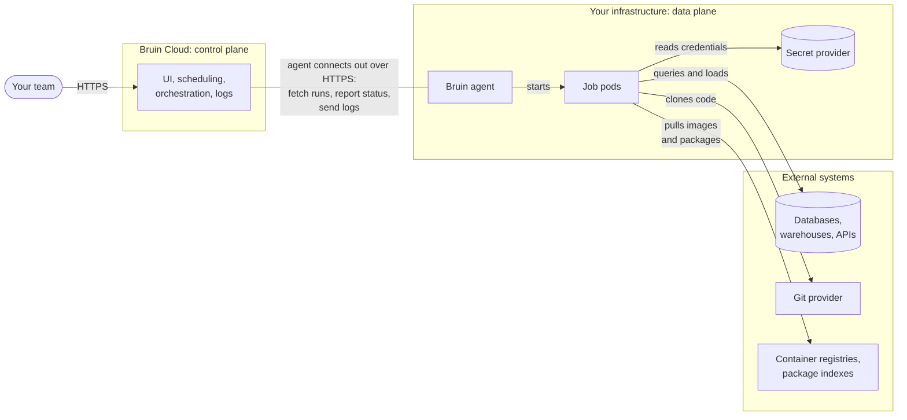

# Hybrid Deployment

Hybrid mode splits Bruin Cloud into two parts:

- The **control plane** decides what runs and when. Bruin hosts it.
- The **data plane** does the actual work: it runs your assets, connects to your data platforms, and uses your credentials. You host it in your own infrastructure.

You still manage, schedule, and monitor pipelines from the Bruin Cloud UI as usual. The difference is where the work happens: your data and credentials stay inside your network, and Bruin Cloud only receives run status and logs.

## Architecture

- **Control plane (Bruin Cloud):** the UI, scheduling, run orchestration, metadata, and logs.
- **Data plane (your infrastructure):** a lightweight Bruin agent and the short-lived job pods it starts for each asset run.

Every connection between the two planes is opened by the agent, from inside your network. Bruin Cloud never connects into your network, so you don't need to open any inbound ports. Traffic between your data plane and your own systems, such as databases and secret providers, doesn't pass through Bruin Cloud.

## Supported Targets

You can run the data plane on either of these:

- **Kubernetes:** any Kubernetes cluster, managed (EKS, GKE, AKS) or self-hosted, on one of the three most recent minor versions.
- **Virtual machine:** Ubuntu 22.04 LTS, Ubuntu 24.04 LTS, or Debian 12.

Only x86_64 (amd64) nodes are supported. ARM64 nodes, such as AWS Graviton, are not supported.

## Sizing

| Resource | Minimum | Recommended starting point |
|----------|---------|----------------------------|
| CPU | 4 vCPU | 8 vCPU |
| Memory | 16 GB | 32 GB |
| Disk | 128 GB | 128 GB or more |

Examples of instance types at each tier:

| Cloud | Minimum | Recommended starting point |
|-------|---------|----------------------------|
| AWS | `m6i.xlarge` | `m6i.2xlarge` |
| Google Cloud | `n2-standard-4` | `n2-standard-8` |
| Azure | `Standard_D4s_v5` | `Standard_D8s_v5` |

Bruin's own components use very few resources, so how big your cluster needs to be depends on the jobs you run: how many run at the same time, and how much CPU and memory each one needs. Start with a single node at the recommended size and scale up as your workload grows.

### Instance Types and Node Size

Hybrid jobs use the same [instance types](/cloud/instance-types) as Bruin Cloud. A job runs on a single node, so each node must be larger than the biggest instance type your assets use. For example, an asset on `b1.6xlarge` (32Gi memory) will not fit on a node with 32 GB of memory, because the operating system and Kubernetes also need some memory. Use a larger node, or a separate node group for large jobs.

### Autoscaling

On Kubernetes, use a node autoscaler such as [Cluster Autoscaler](https://github.com/kubernetes/autoscaler/tree/master/cluster-autoscaler) or [Karpenter](https://karpenter.sh/) if your workload varies over the day, for example a burst of nightly ingestion jobs. Keep at least one node running, and let the autoscaler add nodes while jobs are waiting to be scheduled.

### Disk

The disk requirement is for the node's own disk. Bruin doesn't need persistent volumes. The disk holds container images, package caches, and temporary files written while assets run. Use SSD-backed storage, such as `gp3` on AWS.

## Installation

Bruin provides a Helm chart for deploying the data plane. Your account manager will share the chart and work through the installation with your team.

## Network Egress

The data plane needs outbound HTTPS (port 443) access to the following domains:

| Purpose | Domains |
|---------|---------|
| Bruin control plane | `getbruin.com`, `*.getbruin.com` |
| Google Cloud APIs | `*.googleapis.com`, `*.google.com` |
| Source and release downloads | `github.com`, `*.github.com`, `githubusercontent.com`, `*.githubusercontent.com` |
| Python packages and tooling | `pypi.org`, `*.pypi.org`, `pythonhosted.org`, `*.pythonhosted.org`, `astral.sh`, `*.astral.sh` |
| Container images | `docker.com`, `*.docker.com`, `docker.io`, `*.docker.io`, `ghcr.io`, `*.ghcr.io`, `registry.k8s.io` |

It also needs access to the systems your pipelines use, such as your Git provider, databases, data warehouses, and any APIs your assets call.

## Credentials and Data

Connection credentials stay in your infrastructure. Bruin Cloud never stores them. Keep them in one of the [supported secret providers](/secrets/overview), and the data plane reads them when a job runs.

Assets run inside your network, so your data is processed there. Run logs are sent to Bruin Cloud so you can view them in the UI along with the rest of your runs.

## Related

- [Instance Types](/cloud/instance-types)
- [Concurrency & Resource Limits](/getting-started/concurrency)
- [Security](/cloud/security)
