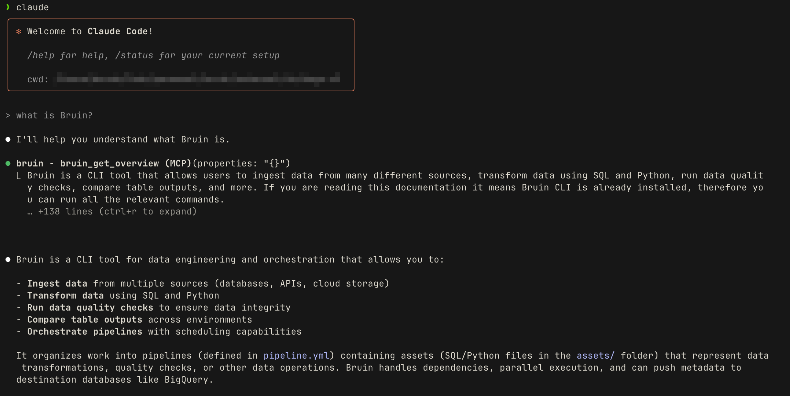

# Bruin MCP

Bruin is a CLI tool that allows users to ingest data from many different sources, transform data using SQL, Python, and R, run data quality checks, compare table outputs, and more.



Bruin MCP allows you to extend your AI agents to analyze, understand, and build upon your data using Bruin CLI. It allows AI agents to query data, compare tables, ingest data, and build pipelines on them.

## Setup

:::tip
Please make sure you have [Bruin CLI installed](/getting-started/introduction/installation.md).
:::

### Use the full path to `bruin`

The Bruin installer puts the `bruin` binary in `~/.local/bin` and adds that folder to `PATH` in your shell profile (`~/.zshrc`, `~/.bashrc`, etc.). Your terminal reads that profile, but editors and desktop apps opened from the Dock, Start menu or app launcher usually don't. Cursor, VS Code, Claude Desktop, GitHub Copilot in JetBrains IDEs, Visual Studio, Xcode and Eclipse, and the Codex app and IDE extension all fall into this group. If you configure the MCP server with just `bruin`, these apps can fail to start it, often without any error message.

To avoid this, use the full path to the `bruin` binary in your MCP configuration. To find it on macOS or Linux, run:

```bash
which bruin
# e.g. /Users/yourname/.local/bin/bruin
```

On Windows, open **Git Bash** (not PowerShell or Command Prompt; it ships with [Git for Windows](https://git-scm.com/download/win)) and run:

```bash
cygpath -m "$(which bruin)"
# e.g. C:/Users/YourName/.local/bin/bruin.exe
```

The examples below use `/path/to/bruin` as a placeholder. Replace it with the path you got here. The CLI commands for Claude Code, Codex and Copilot CLI fill in the path for you via `$(which bruin)`.

### Claude Code

Run the following command in your terminal:

```bash
claude mcp add --scope user bruin -- "$(which bruin)" mcp
```

`--scope user` makes Bruin MCP available in all of your projects. Leave it out to add it to the current project only.

Run `claude mcp list` to check that the `bruin` server is connected.

### Cursor IDE

Add the following configuration to `~/.cursor/mcp.json` (create the file if it doesn't exist). To set Bruin MCP up for a single project instead, use `.cursor/mcp.json` in the project folder. You can also add and manage MCP servers from the **Customize** page in Cursor.

```json
{
  "mcpServers": {
    "bruin": {
      "command": "/path/to/bruin",
      "args": ["mcp"]
    }
  }
}
```

### VS Code

There are two ways to set up Bruin MCP in VS Code:

#### Option 1: Edit the mcp.json file

1. Open the Command Palette with `Cmd+Shift+P` (macOS) or `Ctrl+Shift+P` (Windows/Linux) and run **MCP: Open User Configuration**. This opens your user-level `mcp.json` file, which for the default profile lives at:
   - **macOS**: `~/Library/Application Support/Code/User/mcp.json`
   - **Windows**: `%APPDATA%\Code\User\mcp.json`
   - **Linux**: `~/.config/Code/User/mcp.json`

   To set Bruin MCP up for a single workspace instead, use `.vscode/mcp.json` in the workspace folder.

2. Add the following configuration to the file:

```json
{
  "servers": {
    "bruin": {
      "type": "stdio",
      "command": "/path/to/bruin",
      "args": ["mcp"]
    }
  }
}
```

:::tip
If you already have other MCP servers configured, merge the `bruin` entry into your existing `servers` object rather than replacing the entire file.
:::

3. Restart your IDE.

#### Option 2: Add from Command Palette

1. Open the Command Palette with `Cmd+Shift+P` (macOS) or `Ctrl+Shift+P` (Windows/Linux).
2. Run **MCP: Add Server**.
3. Select **Command (stdio)** as the server type.
4. Enter `/path/to/bruin mcp` as the command.
5. Restart your IDE.

### Codex

The Codex CLI, the Codex app and the Codex IDE extension share the same configuration file, `~/.codex/config.toml`, so you only need to set this up once.

Run the following command in your terminal:

```bash
codex mcp add bruin -- "$(which bruin)" mcp
```

Or add the server to `~/.codex/config.toml` by hand:

```toml
[mcp_servers.bruin]
command = "/path/to/bruin"
args = ["mcp"]
```

Run `codex mcp list` to check that the server is registered, and `/mcp` inside a Codex session to see the Bruin tools.

### GitHub Copilot

GitHub Copilot can use Bruin MCP in your editor, in the Copilot CLI, and in the Copilot coding agent on GitHub.

:::tip
On Copilot Business or Enterprise, an organization or enterprise admin has to turn on the **MCP servers in Copilot** policy first. It is off by default. Copilot Free, Pro and Pro+ users don't need it.
:::

#### VS Code

Copilot Chat in VS Code reads the MCP servers you set up in [VS Code](#vs-code), so follow those steps. Then open Copilot Chat, switch to **Agent** mode, and click the tools icon to check that the Bruin tools are listed.

#### JetBrains IDEs, Visual Studio, Xcode and Eclipse

Copilot in these editors keeps MCP servers in an `mcp.json` file. Open it from Copilot:

- **JetBrains IDEs**: click the Copilot icon in the bottom-right corner, select **Open Chat**, switch to **Agent** mode, click the tools icon, then **Add MCP Tools**.
- **Visual Studio** (17.14 or newer): open **View > GitHub Copilot Chat**, switch to **Agent** mode, click the tools icon, then the plus icon.
- **Xcode**: open the **GitHub Copilot for Xcode** app settings, go to the **MCP** tab, then click **Edit Config**.
- **Eclipse**: click the Copilot icon in the status bar, select **Open Chat**, then click the **Configure Tools...** icon.

Add the `bruin` server to the file:

```json
{
  "servers": {
    "bruin": {
      "type": "stdio",
      "command": "/path/to/bruin",
      "args": ["mcp"]
    }
  }
}
```

Save the file and start a new chat in **Agent** mode.

#### Copilot CLI

Run the following command in your terminal:

```bash
copilot mcp add bruin -- "$(which bruin)" mcp
```

This adds the server to `~/.copilot/mcp-config.json`. You can also add it from inside a Copilot session with `/mcp add`, or write the file by hand:

```json
{
  "mcpServers": {
    "bruin": {
      "type": "local",
      "command": "/path/to/bruin",
      "args": ["mcp"],
      "tools": ["*"]
    }
  }
}
```

Run `copilot mcp list` to check that the server is registered, and `/mcp show bruin` inside a Copilot session to see the Bruin tools.

#### Copilot coding agent

The Copilot coding agent works on GitHub's runners, so Bruin has to be installed there before the agent starts. Add a `.github/workflows/copilot-setup-steps.yml` file to your repository's default branch. The job must be called `copilot-setup-steps`, otherwise Copilot ignores it:

```yaml
name: "Copilot Setup Steps"

on:
  workflow_dispatch:
  push:
    paths:
      - .github/workflows/copilot-setup-steps.yml
  pull_request:
    paths:
      - .github/workflows/copilot-setup-steps.yml

jobs:
  copilot-setup-steps:
    runs-on: ubuntu-latest
    permissions:
      contents: read
    steps:
      - uses: actions/checkout@v5
      - uses: bruin-data/setup-bruin@main
```

Then go to your repository's **Settings > Copilot > MCP servers**, paste the following into **MCP configuration**, and click **Save MCP configuration**:

```json
{
  "mcpServers": {
    "bruin": {
      "type": "local",
      "command": "bruin",
      "args": ["mcp"],
      "tools": ["*"]
    }
  }
}
```

The coding agent runs MCP tools without asking for approval. If Bruin needs credentials, add them as secrets to the repository's `copilot` environment with names that start with `COPILOT_MCP_`, and pass them to the server under `env` in the MCP configuration. Copilot doesn't pass secrets without that prefix to MCP servers.

To check the setup, assign an issue to Copilot, open the agent session logs, and expand the **Start MCP Servers** step. The Bruin tools are listed there.

### Troubleshooting

- **The `bruin` server fails to start, or its tools never show up.** The app can't find the `bruin` binary. Use the full path as described in [Use the full path to `bruin`](#use-the-full-path-to-bruin), then restart the app.
- **Codex asks for approval on every Bruin tool call, or `codex exec` fails with `MCP tool call requires approval`.** Bruin CLI versions newer than v0.11.830 mark the Bruin MCP tools as read-only, so Codex can run them without asking. Run `bruin upgrade` to get the latest version.
- **You want to see what the server is doing.** Add `--debug` to the arguments (e.g. `"args": ["mcp", "--debug"]`). The server then logs every request and response to stderr, which most clients show in their MCP logs.

## Bruin Environment Setup

In order to make use of Bruin MCP, you need to have a Bruin project. A Bruin project is a folder that contains a `.bruin.yml` file.

The simplest way to get started is to create a new Bruin project using `bruin init` command.

```bash
# Initialize a new Bruin project with a DuckDB template
bruin init duckdb

# If you don't give any arguments, it will ask you to select a template
bruin init
```

This will create a new Bruin project with a DuckDB database as a starting point.

You can:

- [Read more about project configuration](/core-concepts/project) for your data warehouse or other sources.
- [Programmatically add connections](/commands/connections#add-connection).
- Use our [VS Code / Cursor extension](/vscode-extension/overview) to add connections.

Bruin allows you to use different environments for your projects. You can [read more about project configuration](/core-concepts/project) to learn more.

## Usage

There are a couple of areas Bruin MCP can be helpful for you. Bruin CLI has complete functionality, and MCP is a simple layer to bridge the gap between the CLI and the AI editor.

### Analyzing data

Bruin CLI already has the ability to run queries across different databases. MCP server allows your AI agents to understand how to run queries on the given databases.

A common example is to ask the AI agent to analyze a data in a certain table, such as "What is the average revenue of the products in the products table?" or "What is the total revenue of the orders in the orders table?"

### Data ingestion

Bruin already has connectors for [tens of sources](/ingestion/overview), Bruin MCP allows your AI agents to understand how to ingest data from the given sources.

You can use Bruin MCP to get data from Shopify, for instance. You can simply say "bring all of my Shopify order data into BigQuery", and just enjoy the rest.

### Data comparison

A common task when dealing with changes in data pipelines is to compare data between two different environments. You create a new version of the table in your development environment, and you want to compare it with the production table to make sure it's correct.

Thankfully, Bruin CLI already supports:

- [environments](/core-concepts/project)
- [data-diff](/commands/data-diff) command

Using the Bruin MCP server, you can build new data models while ensuring that the data is correct and up-to-date using AI.

## And more

Once MCP setup is complete, you can ask your AI agent questions like:

- "How do I create a BigQuery asset in Bruin?"
- "How is a pipeline.yml file configured in Bruin?"
- "What data sources does Bruin support for ingestion?"
- "How do I set up a Snowflake connection in Bruin?"
- "How can I connect to my PostgreSQL database and run a query with Bruin?"
- "How do I create a table in my data warehouse using Bruin?"
- "How can I build a data pipeline in Bruin for ingesting CSV files?"
- "How do I run data quality checks on my tables in Bruin?"

Or you can give direct commands like:

- "Create a BigQuery asset in Bruin"
- "Configure a pipeline.yml file in Bruin"
- "Show me the data sources Bruin supports for ingestion"
- "Set up a Snowflake connection in Bruin"
- "Connect to my PostgreSQL database and run a query with Bruin"
- "Create a table in my data warehouse using Bruin"
- "Build a data pipeline in Bruin for ingesting CSV files"
- "Run data quality checks on my tables in Bruin"

The AI assistant will answer these questions using up-to-date Bruin documentation and provide you with accurate examples. It can also execute Bruin commands directly to help you connect to databases, run queries, perform ingestion workflows, and create complete data pipelines.

## Best Practices for AI Agents

### Use `agents.md` Files

Add `agents.md` files to guide AI agents working in your repository:

**Root level** - Keep it high-level:
- What the project does
- How to navigate the repo
- Available connections and their access levels

**Per-pipeline/domain** - Be specific:
- What data lives here and its schema
- Typical tasks the agent should handle
- Constraints (read-only vs write, dev vs prod)

### Document Pitfalls

In each `agents.md`, list common mistakes:
- Time zone handling (e.g., "all timestamps are UTC")
- Data arrival delays (e.g., "15-minute sync lag")
- Schema gotchas (e.g., "`customer_id` is NULL for guest checkouts")
- Known data quality caveats

### Use Custom Checks as Examples

Point agents to existing custom checks instead of writing ad-hoc queries:
```markdown
| Question | Use This Check |
|----------|----------------|
| Is revenue valid? | `check_revenue_not_negative` |
| Is data fresh? | `check_data_freshness` |
```

### Default to Dev Environments

Configure your project so agents use dev by default:
```yaml
# pipeline.yml
dev:
  schema_prefix: dev_agent_
```

Make this explicit in `agents.md` so agents know dev is safe for experimentation and prod requires explicit access.

## Feedback

We'd love to hear your feedback on Bruin MCP. Please [create an issue](https://github.com/bruin-data/bruin/issues/new) so that we can improve Bruin CLI & Bruin MCP.
