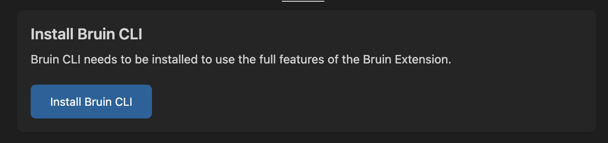

# Installation

Bruin has two high-level components that make it work best:

- a command-line interface (CLI) application: [Bruin CLI](https://github.com/bruin-data/bruin)
- a Visual Studio Code extension: [VS Code Extension](https://marketplace.visualstudio.com/items?itemName=bruin.bruin)

We recommend installing both of these components to make the most of the Bruin experience.

## Prerequisites

Bruin requires a few components to be installed:

- [Git](https://git-scm.com/downloads)
- [Visual Studio Code](https://code.visualstudio.com/download): optional, but highly recommended

In addition, there are some optional components:

- [DuckDB](https://duckdb.org/docs/installation/): optional, useful for the tutorials in this documentation

## Bruin CLI

### Install using `curl`

Use `curl` to install Bruin on macOS, Linux or Windows:

```shell
curl -LsSf https://getbruin.com/install/cli | sh
```

Or you can also use `wget` to install Bruin:

```shell
wget -qO- https://getbruin.com/install/cli | sh
```

> [!NOTE]
> The Homebrew installation method is **deprecated**. If you previously installed Bruin using `brew`, uninstall it first before running the `curl` command.
> [!IMPORTANT]
> If you are on Windows, make sure to run the command in the [Git Bash](https://git-scm.com/downloads/win) or [WSL](https://learn.microsoft.com/en-us/windows/wsl/install) terminal.

### Bruin home directory

Set the global `BRUIN_HOME` environment variable to a writable, dedicated directory to relocate Bruin's runtime tools and state. This is useful when your user home is read-only or unavailable:

```shell
export BRUIN_HOME=/work/bruin-home
bruin run ./my-pipeline
```

In PowerShell, use `$env:BRUIN_HOME = 'D:\bruin-home'`.

- Bruin stores uv, ingestr, virtual environments, R caches, and telemetry state there instead of `~/.bruin`.
- DuckDB and Spark ADBC drivers are installed and loaded from `$BRUIN_HOME/adbc`.
- uv's package cache, managed Python installations, and tools use this directory too. Explicit `UV_CACHE_DIR`, `UV_PYTHON_INSTALL_DIR`, `UV_TOOL_DIR`, and `UV_TOOL_BIN_DIR` settings take precedence. Existing uv-managed caches outside `~/.bruin` are not copied.

On first use, Bruin copies existing files from `~/.bruin`, preserving file permissions and symlinks without deleting the originals or replacing destination files. Existing ADBC drivers are copied from the platform's user ADBC directory when needed (typically `~/.config/adbc/drivers` on Linux); their manifests are updated to point to the new location. This is a one-time migration, not ongoing synchronization. Automatic migration covers the legacy locations, not another custom `BRUIN_HOME`.

Use an absolute path for consistent behavior across projects. Relative paths resolve from the current working directory. Leave `BRUIN_HOME` unset or empty to keep the default locations. The variable does not relocate the Bruin CLI executable, project `.bruin.yml` files, project logs, Cloud login configuration, or third-party tools' own storage such as DuckDB extensions.

`bruin clean` clears the selected Bruin home, so do not point it at a directory containing unrelated files.

## Bruin VSCode Extension

1. **Open Visual Studio Code**: Launch VS Code on your computer.
2. **Go to Extensions**: Click the Extensions icon in the Activity Bar.
3. **Search for "Bruin"**: type "Bruin" in the Extensions search bar.
4. **Install the Extension**: Click the Install button next to the Bruin extension in the results. You can also check the "Auto Update" option to ensure you don't miss out on new features and fixes.

   

5. **Check Bruin CLI Installation**:
    - When you click the **Bruin Launch** button, the extension checks if Bruin CLI is installed.
    - If the CLI is **not installed**, a message will appear in the **Settings** tab with a button to install it.



That's it, you are ready to roll with Bruin.

## Troubleshooting

### 'Permission Denied' error during the CLI installation

**Issue**  
When installing the Bruin CLI, you may encounter a `'Permission Denied'` error. This typically happens if the user doesn't have permission to write the binary to the `~/.local/bin` directory.

**Solution**  
Ensure that your user has write permission to `~/.local/bin`, then rerun the installer without `sudo`. Running the default installer with `sudo` can install Bruin into root's home instead of your own.

Alternatively, on macOS or Linux, install system-wide by explicitly selecting a directory on your `PATH`:

```shell
curl -LsSf https://getbruin.com/install/cli | sudo sh -s -- -b /usr/local/bin
```
